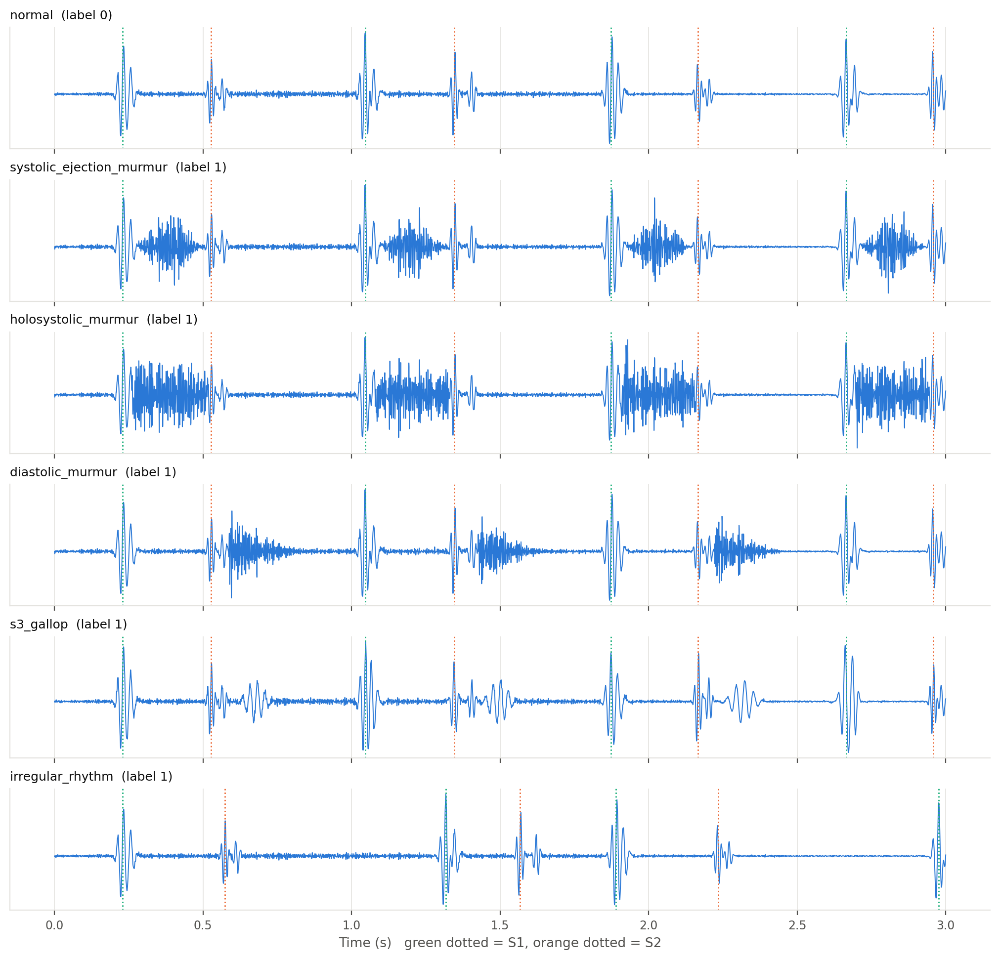
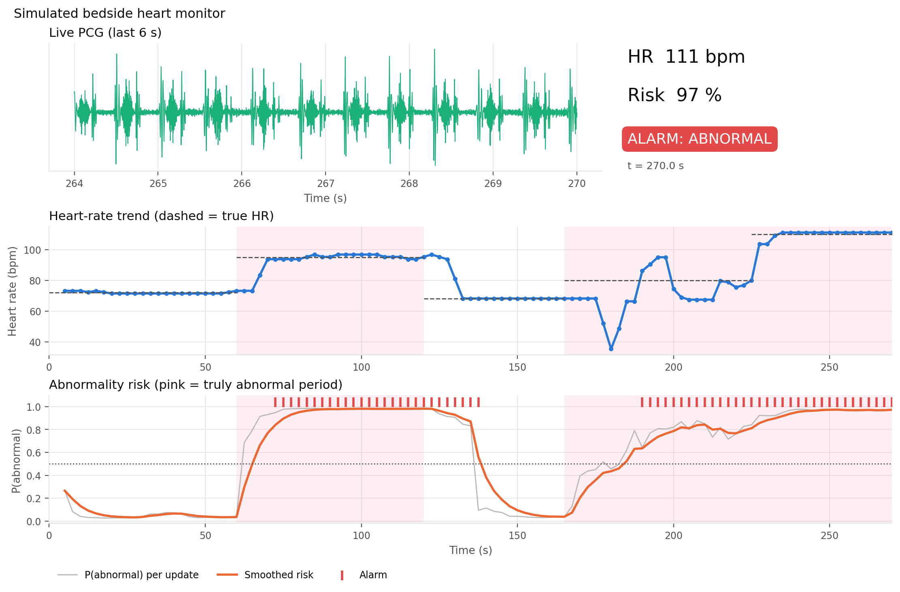
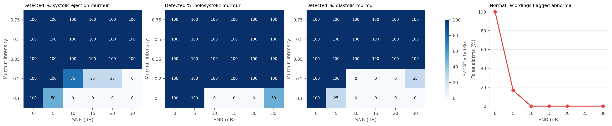
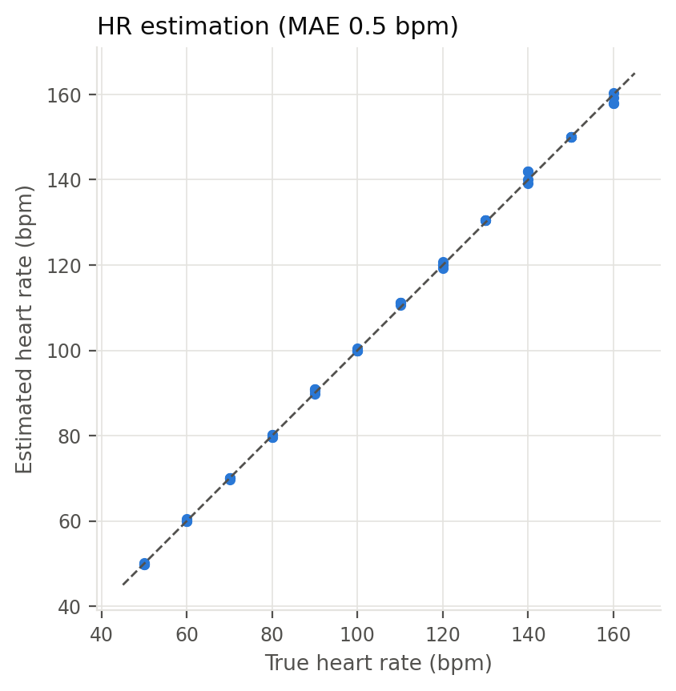
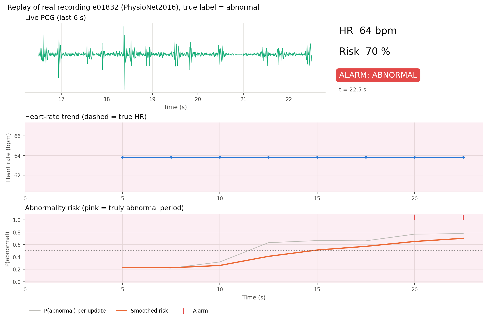

# Heart Monitoring System – Working Simulation Model

Heart sound (PCG) abnormality detection turned into a real-time heart monitoring simulation.

**Course:** Mathematics behind AI · M.Tech in Artificial Intelligence, Thapar Institute of Engineering & Technology
**Authors:** Shreya Das, Tejashwini Yadav

---

## Overview

This project builds a heart sound abnormality detector from first principles. It then turns the detector into a **working simulation of a heart monitoring system**. The simulation generates heart sounds mathematically, streams them through the detector, estimates heart rate and raises alerts when the condition changes.

## What's inside

1. **Mathematical PCG generator.** It synthesises heart sounds beat by beat. S1 and S2 are modelled as Gaussian-modulated sinusoids, and RR intervals follow respiratory sinus arrhythmia. It simulates these conditions:
   - normal
   - systolic ejection murmur
   - holosystolic murmur
   - diastolic murmur
   - S3 gallop
   - irregular rhythm
2. **Signal processing.** Polyphase resampling and a 4th-order zero-phase Butterworth band-pass filter (25–400 Hz).
3. **Feature extraction.** MFCC (STFT → mel filterbank → log → DCT-II), Welch spectral features, and other time/frequency feature groups.
4. **Classifiers.** Logistic regression, LDA, SVM (RBF), random forest and gradient boosting, evaluated with stratified group cross-validation.
5. **Statistics.** t-distribution confidence intervals, Wilcoxon signed-rank test, Nadeau–Bengio corrected t-test and bootstrap CIs.
6. **Monitoring simulation.** A patient session whose condition changes over time, robustness to noise, heart-rate estimation accuracy and replay of real recordings.

## Results

### Synthetic heart sounds


### Simulated monitoring session


### Robustness to noise


### Heart-rate estimation accuracy


### Real recording replayed through the monitor


Result tables (CSV) are in [`results/simulation/tables`](results/simulation/tables) and [`results/tables`](results/tables).

## Repository structure

```
├── HEART_MONITORING_SIMULATION_MODEL_.ipynb   # main notebook (Google Colab)
├── results/
│   ├── simulation/
│   │   ├── figures/                    # simulation graphs
│   │   ├── tables/                     # simulation result tables
│   │   └── heart_monitor_model.joblib  # trained monitor model
│   └── tables/                         # classifier experiment results
└── README.md
```

## How to run

Open `HEART_MONITORING_SIMULATION_MODEL_.ipynb` in **Google Colab** and choose **Runtime → Run all**.
The notebook downloads the PhysioNet 2016 dataset on its first run. To use synthetic heart sounds only, set `USE_REAL_DATA = False`.

## Dataset

- [PhysioNet/CinC Challenge 2016](https://physionet.org/content/challenge-2016/1.0.0/): 3,240 heart sound recordings from six sites
- [CirCor DigiScope (PhysioNet 2022)](https://physionet.org/content/circor-heart-sound/1.0.3/)

The datasets are not included in this repository. The notebook downloads them.

## Tech stack

Python · NumPy · SciPy · pandas · scikit-learn · Matplotlib · ipywidgets
